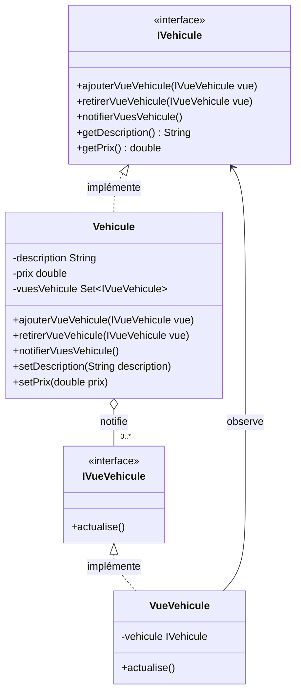

# Patron Observateur en Java

Ce projet est une application console Java qui présente une implémentation du
patron de conception **Observateur** avec Maven.

## Rôle du patron Observateur

Le patron Observateur définit une relation entre un objet principal, appelé
**sujet observé**, et plusieurs objets dépendants, appelés **observateurs**.
Lorsque l'état du sujet change, celui-ci informe automatiquement tous les
observateurs inscrits.

Ce patron permet notamment de :

- notifier plusieurs objets à partir d'une seule modification ;
- ajouter ou retirer des observateurs sans modifier le sujet ;
- réduire le couplage entre l'objet observé et ses vues ou dépendances.

## Exemple traité

L'exemple représente un véhicule et ses vues :

## Architecture UML

Le diagramme suivant présente les relations entre le sujet observé, les
observateurs et leurs interfaces :

`App.java` crée un `Vehicule`, lui associe plusieurs `VueVehicule`, puis
déclenche des notifications lorsque sa description ou son prix change.
