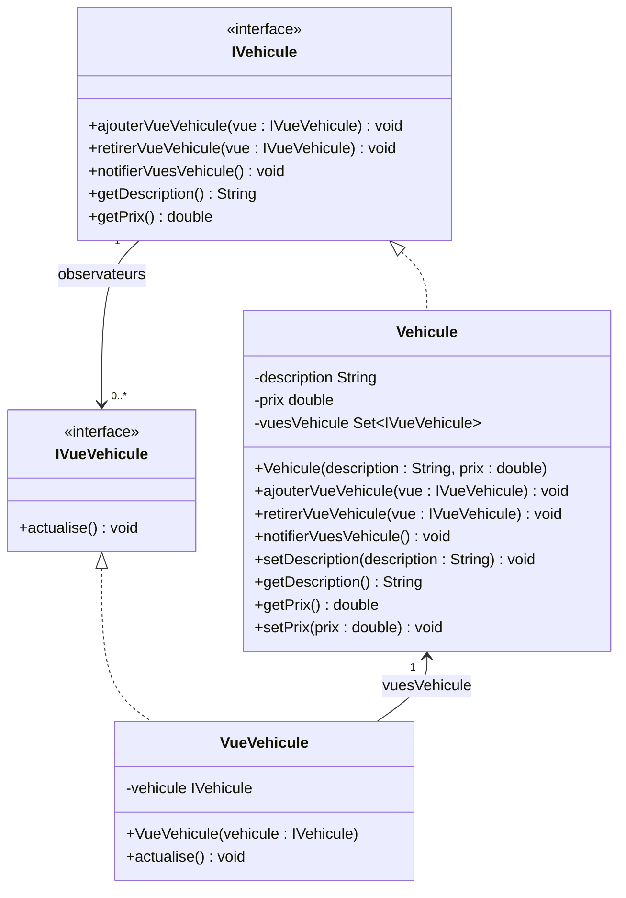

# Patron Observateur en Java

Ce projet est une application console Java qui présente une implémentation du
patron de conception **Observateur** avec Maven.

## Rôle du patron Observateur

Le patron Observateur définit une relation entre un objet principal, appelé
**sujet observé**, et plusieurs objets dépendants, appelés **observateurs**.
Lorsque l'état du sujet change, celui-ci informe automatiquement tous les
observateurs inscrits.

Ce patron permet notamment de :

- notifier plusieurs objets à partir d'une seule modification ;
- ajouter ou retirer des observateurs sans modifier le sujet ;
- réduire le couplage entre l'objet observé et ses vues ou dépendances.

## Exemple traité

L'exemple représente un véhicule et ses vues :

`IVehicule` joue le rôle du sujet abstrait et `Vehicule` celui du sujet
concret. `IVueVehicule` représente l'observateur abstrait et `VueVehicule`
l'observateur concret.

## Architecture UML

Le diagramme correspond à l'implémentation présente dans le code :

La relation entre `IVehicule` et `IVueVehicule` est unidirectionnelle : un sujet
peut gérer zéro à plusieurs observateurs. Dans l'implémentation concrète,
`Vehicule` est associé à plusieurs `VueVehicule`. Le constructeur de
`VueVehicule` reçoit bien une référence de type `IVehicule`, mais cette
dépendance d'implémentation n'est pas représentée comme une association
visible entre l'interface du sujet et la classe de l'observateur concret.

Lorsque `setDescription` ou `setPrix` modifie réellement l'état du véhicule,
`Vehicule.notifierVuesVehicule()` parcourt `vuesVehicule` et appelle
`actualise()` sur chaque observateur. L'inscription et le retrait des vues
sont réalisés avec `ajouterVueVehicule()` et `retirerVueVehicule()`.
